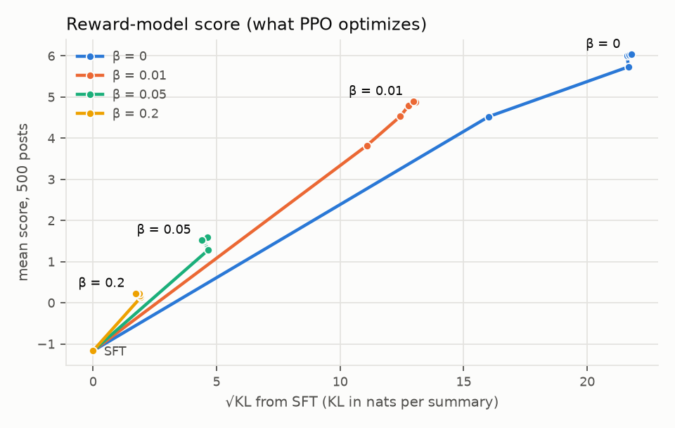
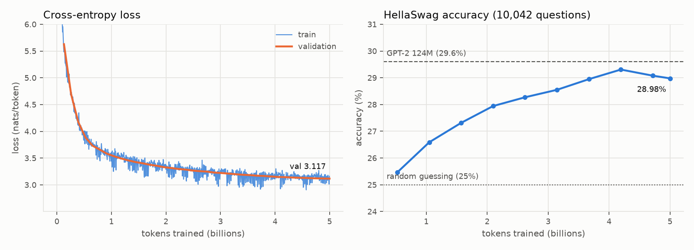

<!--
Before making the repo public:
  1. Replace every TBD with the exact number from results/ (never estimate).
  2. Rewrite every <!- FILL -> section in your own words, based on what actually happened.
  3. Delete any row or section for something you didn't run (e.g. GRPO, 350M).
  4. Make sure every image in assets/ exists.
  5. Delete this comment.
-->

# rlhf-from-scratch


A 124M-parameter language model that I wrote, pretrained from random weights, and then aligned with RLHF, all in Torch. It doesn't use Hugging Face's `transformers` or `trl` libraries. Attention, the KV cache, the reward model, PPO and DPO are all implemented in this repo, and each piece has tests.

The post-training task is Reddit summarization, the same setup OpenAI used in [*Learning to summarize from human feedback*](https://arxiv.org/abs/2009.01325) (Stiennon et al., 2020). The model learns to write TL;DRs from about 117K human-written examples, a reward model learns what people prefer from 92,858 human comparisons (91,801 after dropping pairs with summaries over 80 tokens), and PPO trains the model to score well on that reward model without drifting too far from where it started.

```
random weights
  -> pretraining     ~5B tokens of FineWeb-Edu (4,999,610,368)
  -> SFT             116,722 Reddit posts with human-written TL;DRs
  -> reward model    92,858 human preference comparisons
  -> PPO             KL-penalized against the SFT model   (DPO trained as a baseline)
```

I built this to understand how post-training actually works, at a scale where I could run every stage myself on a university GPU cluster.

## Results

All numbers are on 500 held-out Reddit posts from the TL;DR test split. **Win rate** is how often an LLM judge (Claude, model id in `results/`) preferred the model's summary over the human-written TL;DR. Every pair is judged in both orders to cancel out position bias; a split decision counts as a tie. Brackets are 95% bootstrap intervals.

| Model | Win rate vs. human TL;DR | KL from SFT (nats) | Avg. length (tokens) |
|---|---|---|---|
| SFT | TBD [TBD, TBD] | 0 | TBD |
| DPO (β = 0.1) | TBD [TBD, TBD] | TBD | TBD |
| PPO (β = 0.05) | TBD [TBD, TBD] | TBD | TBD |
| PPO, no KL penalty | TBD [TBD, TBD] | TBD | TBD |

To check the judge, I labeled 150 pairs myself without knowing which model wrote which summary. The judge agreed with me on **TBD%** of them. The reward model agreed with me on TBD%.

### Reward hacking

The reward model is only a proxy for what people want, and a 124M reward model is not a very good one. So I trained PPO at four KL-penalty strengths and tracked two things as each policy moved away from the SFT model: the reward model's score (what PPO is optimizing) and the judge's win rate (a stand-in for actual quality).



<!-- FILL: 2-4 sentences describing what the figure actually shows. For example, where the judge
curve peaks, what happens to it with no KL penalty, and by how much the proxy score and judged
quality diverge. Only describe what the plot shows. -->

What that looks like in practice, on one held-out post:

| | Summary |
|---|---|
| Human | TBD |
| SFT | TBD |
| PPO (β = 0.05) | TBD |
| PPO, no KL penalty | TBD |

More side-by-side examples are in [`results/hacking_examples.md`](results/hacking_examples.md).

### Pretraining

| | Params | Tokens | Val loss | HellaSwag | Hardware | Time |
|---|---|---|---|---|---|---|
| This model | 123,587,328 | 4,999,610,368 | 3.117 | 28.98% | 1× A100 80GB | 9.58 h |
| GPT-2 small (OpenAI, for reference) | 124M | WebText | n/a | 29.6% | | |



### Reward model

- Accuracy on 83,675 held-out human comparisons: **60.78%** (Huang et al. report 62.8% to 68.9% for 1B to 6.9B models on the same data).
- Accuracy rises with the labeler's stated confidence: 54.60% on pairs the labeler was least sure about vs. 65.87% on pairs they were most sure about.
- Correlation between reward and summary length on 1,000 SFT samples: Spearman ρ = 0.068. <!-- FILL: one sentence on whether this predicted PPO's length behavior. -->

## How it works

### Model (`src/rlhf/model/`)

A decoder-only transformer with the components modern open models use rather than the original GPT-2 ones: rotary position embeddings (RoPE), RMSNorm, pre-norm residual blocks, a SwiGLU MLP, no bias terms, and tied input/output embeddings. 12 layers, 12 heads, d_model 768, context 1024, GPT-2 tokenizer (via `tiktoken`).

Attention has two code paths: a hand-written one and PyTorch's fused `scaled_dot_product_attention`. A test checks they produce the same output, and training uses the fused one. Generation uses a preallocated KV cache, which matters a lot here because PPO generates hundreds of thousands of summaries. Batched generation left-pads prompts, so position ids are computed from the attention mask; a test checks that padding a prompt doesn't change its output.

With the KV cache, generation runs 7.47× faster than recomputing the full sequence at every step (10,680 vs. 1,429 tokens/s; 256 new tokens, batch 64, one A100). Both paths compute output logits for the last position only, so the comparison isolates the cache.

### Pretraining (`src/rlhf/train/pretrain.py`)

~5B tokens (4,999,610,368) from FineWeb-Edu, tokenized once into `uint16` shards. AdamW with a 0.5M-token batch (via gradient accumulation), linear warmup and cosine decay, bf16 autocast, `torch.compile`, and gradient clipping. Runs as a Slurm job on Princeton's Adroit cluster. Every checkpoint stores the model, optimizer, LR schedule step, dataloader position and RNG state, so a job killed at its time limit resumes exactly where it stopped.

### Supervised fine-tuning (`src/rlhf/train/sft.py`)

Fine-tunes on OpenAI's filtered TL;DR dataset using the prompt format from the paper:

```
SUBREDDIT: r/relationships

TITLE: ...

POST: ...

TL;DR:
```

Loss is computed only on the summary tokens. Long posts are truncated at paragraph boundaries rather than mid-sentence. Padding uses a dedicated pad token instead of end-of-text, which sounds minor but matters later: the reward model and PPO both need to know whether the model actually chose to stop.

### Reward model (`src/rlhf/train/reward.py`)

The SFT model with a scalar head, trained on pairs of summaries that human labelers compared. The loss is the Bradley-Terry objective, `-log σ(r_chosen - r_rejected)`, and the reward is read at the end-of-text token. After training, rewards are shifted so the human reference summaries average zero.

### PPO (`src/rlhf/train/ppo.py`)

Four models are involved: the policy being trained, a frozen copy of the SFT model as a reference, the frozen reward model, and a value model initialized from the reward model. Each iteration:

1. Sample summaries for 512 posts (temperature 0.7).
2. Score each full summary with the reward model. Summaries that never emit end-of-text get a fixed penalty.
3. Give every token a reward of `-β · (log π(token) - log π_ref(token))`, and add the reward model's score on the final token.
4. Compute advantages with GAE (γ = 1, λ = 0.95) and normalize them.
5. Run 4 epochs of clipped PPO updates on the policy and value model.

Most of the implementation choices follow [Huang et al. (2024)](https://arxiv.org/abs/2403.17031), who documented the many small details that make RLHF work on this exact task. The ones that mattered most for me: <!-- FILL: 2-3 details that actually caused problems or made a difference in your runs. -->

### DPO (`src/rlhf/train/dpo.py`)

[Direct Preference Optimization](https://arxiv.org/abs/2305.18290) on the same 92K comparisons, starting from the same SFT model. No reward model and no sampling, so it's much cheaper, which makes it a useful baseline for judging whether PPO's extra complexity paid off.

### Evaluation (`src/rlhf/eval/`)

- LLM judge with both orderings per pair, cached so nothing is paid for twice.
- `scripts/label.py`: a small terminal tool I used to hand-label pairs blind, for measuring judge agreement.
- Bootstrap confidence intervals on every win rate.
- The over-optimization plot evaluates saved PPO checkpoints along the KL axis, following [Gao et al. (2022)](https://arxiv.org/abs/2210.10760).

## Things that broke

<!-- FILL: 2-4 short, specific stories, written as they happen. Real bugs are far more convincing
than a clean write-up. Good candidates: a padding or position-id bug, the first PPO run that
diverged, a log-prob mismatch between rollout and training, something the reward model learned
that it shouldn't have. For each: what you saw, what caused it, how you found it. -->

## Running it

```bash
git clone https://github.com/jaydonsun24/rlhf-from-scratch
cd rlhf-from-scratch
pip install -e ".[dev]"
pytest -q
```

Each stage is one script with a YAML config. Any config value can be overridden from the command line.

```bash
python -m rlhf.data.fineweb tokens=5e9                      # download + tokenize pretraining data
python -m rlhf.data.tldr                                    # SFT data
python -m rlhf.data.preferences                             # human comparisons
torchrun --nproc_per_node=1 -m rlhf.train.pretrain --config configs/pretrain.yaml
python -m rlhf.train.sft     --config configs/sft.yaml
python -m rlhf.train.reward  --config configs/rm.yaml
python -m rlhf.train.dpo     --config configs/dpo.yaml
python -m rlhf.train.ppo     --config configs/ppo.yaml beta=0.05
python -m rlhf.eval.judge    --config configs/eval.yaml     # needs ANTHROPIC_API_KEY
```

To try the whole pipeline on a laptop in a few minutes, add `model=tiny max_steps=20` to any command. Slurm scripts for Princeton's Adroit cluster are in `scripts/slurm/`.

Total compute for everything in this README: about TBD A100-hours.

## Repo layout

```
src/rlhf/
  model/    transformer, RoPE, attention, KV-cache generation
  data/     FineWeb sharding, TL;DR and preference data loading
  rl/       log-probs, GAE, loss functions (Bradley-Terry, DPO, PPO)
  train/    one script per stage
  eval/     judge, agreement, HellaSwag, plots
configs/    YAML configs
scripts/    Slurm jobs, Colab notebook, labeling tool
tests/      unit tests (run on CPU in under a minute)
results/    final metrics as JSON/CSV (every number in this README comes from here)
```

## Limitations

- It's a 124M model, so the summaries are often mediocre even after RLHF. The point of this project is the pipeline and what changes between stages, not the summaries themselves.
- The reward model is much smaller than the ones in the papers this follows, which is part of why it can be exploited.
- The LLM judge is a proxy for human judgment. Its agreement with my labels is reported above, and 150 labels from one person is a limited check.
- Most runs use a single seed.

## References

- Stiennon et al., 2020. [Learning to summarize from human feedback](https://arxiv.org/abs/2009.01325).
- Huang et al., 2024. [The N+ Implementation Details of RLHF with PPO: A Case Study on TL;DR Summarization](https://arxiv.org/abs/2403.17031).
- Ouyang et al., 2022. [Training language models to follow instructions with human feedback](https://arxiv.org/abs/2203.02155).
- Rafailov et al., 2023. [Direct Preference Optimization](https://arxiv.org/abs/2305.18290).
- Schulman et al., 2017. [Proximal Policy Optimization Algorithms](https://arxiv.org/abs/1707.06347).
- Schulman et al., 2015. [High-Dimensional Continuous Control Using Generalized Advantage Estimation](https://arxiv.org/abs/1506.02438).
- Gao, Schulman and Hilton, 2022. [Scaling Laws for Reward Model Overoptimization](https://arxiv.org/abs/2210.10760).
- Su et al., 2021. [RoFormer: Enhanced Transformer with Rotary Position Embedding](https://arxiv.org/abs/2104.09864).
- Penedo et al., 2024. [The FineWeb Datasets](https://arxiv.org/abs/2406.17557).
- Andrej Karpathy's [nanoGPT](https://github.com/karpathy/nanoGPT) and [build-nanogpt](https://github.com/karpathy/build-nanogpt), which I used as a reference for the pretraining setup.

Training ran on Princeton Research Computing's Adroit cluster.
